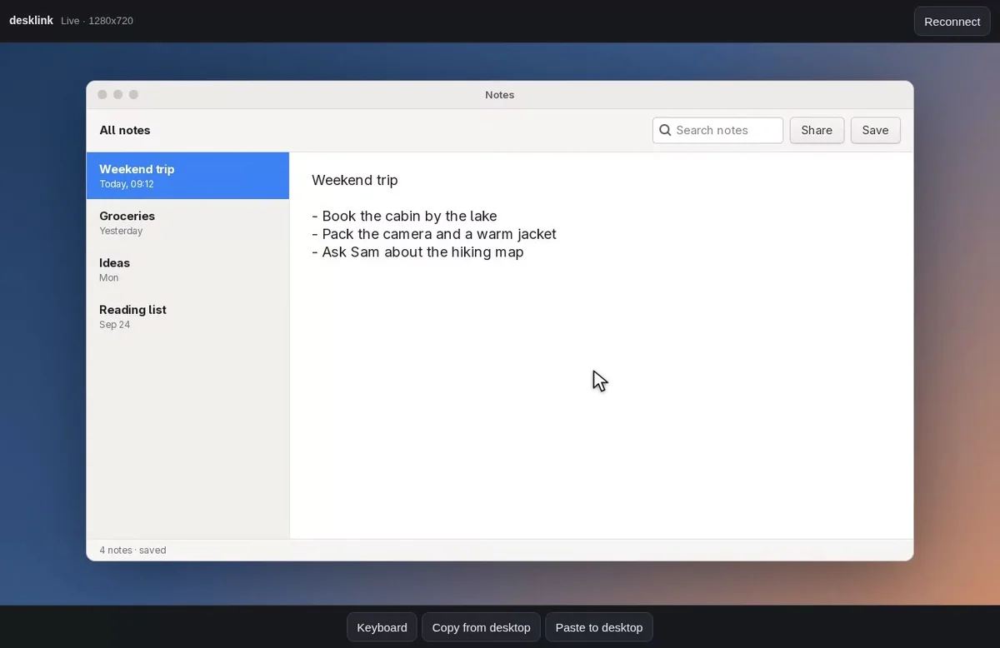
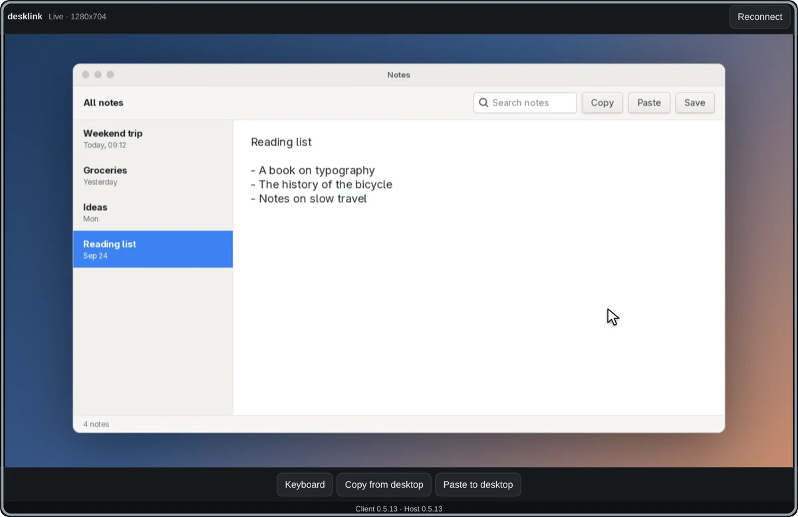
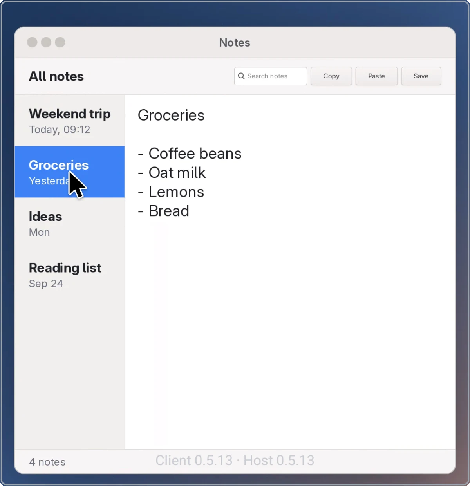
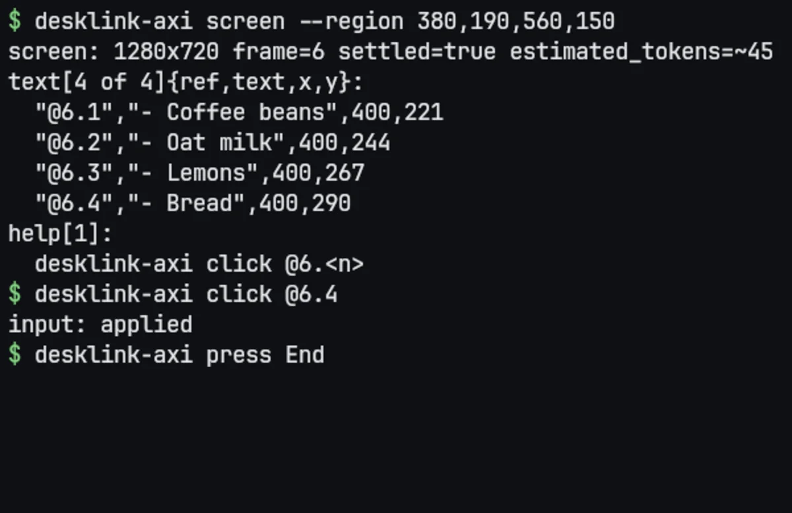
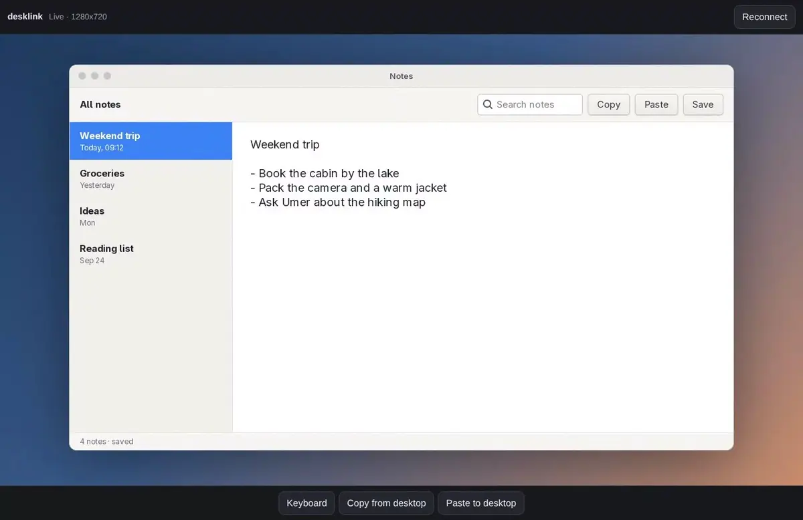

<h1 align="center">desklink</h1>

<p align="center"><strong>Your desktop, right where you need it — in a browser, on a phone, or with an agent.</strong></p>

<p align="center">
  <a href="https://www.npmjs.com/package/@desklink/host"></a>
  <a href="https://github.com/umeranjum17/desklink/actions/workflows/ci.yml"></a>
  <a href="LICENSE"></a>
</p>

<p align="center">
  
</p>

<p align="center"><a href="#try-it">Try it</a> · <a href="packages/desktop-client">Build it into your app</a> · <a href="packages/axi">Give your agent a desktop</a></p>

## Why desklink exists

You already have an app and a way to trust the people using it.
You shouldn't need another account just to bring a desktop into it.
Desklink handles the live picture, clicks, keys and clipboard.
Your app stays in charge of who gets in — and when the session ends.

<details>
<summary>How it fits your app's connection</summary>

The engine is a per-user process, not a service. Your application starts and
stops it, and carries the offer and answer over its own authenticated channel.

An application supplies pairing, identity and signaling transport through the
BYOKit kits — [@byokit/link](https://www.npmjs.com/package/@byokit/link) for pairing
and revocation, [@byokit/relay](https://www.npmjs.com/package/@byokit/relay) for the
relay, [@byokit/reach](https://www.npmjs.com/package/@byokit/reach) for reachable
addresses. Desklink implements none of those pieces; the app adapts its channel
to the client's [Signaling interface](packages/desktop-client/README.md#signaling).
The app maps each pairing to the sessions it opened; on revocation it explicitly
closes those sessions and refuses future opens from that pairing. Dropping
signaling alone does not revoke a retained bridge session. WebRTC media and input
use a separate session, with app-supplied `iceServers` when needed; a signaling
relay alone does not relay that traffic.

See [where each piece's responsibility ends](packages/desktop-host/docs/BOUNDARY.md)
and the [local protocol](packages/desktop-host/docs/PROTOCOL.md).

</details>

## One desktop. A few ways in.

<table>
  <tr>
    <td width="50%"><br/><strong>In your browser</strong><br/>Click, type and scroll. No client build needed.</td>
    <td width="50%"><br/><strong>In your phone app</strong><br/>The React Native view, on an Android emulator.</td>
  </tr>
  <tr>
    <td width="50%"><br/><strong>With your agent</strong><br/>Read the screen as text. Ask for pixels when needed.</td>
    <td width="50%"><br/><strong>Keys and clipboard, too</strong><br/>Hold Ctrl. Copy text over and send it back.</td>
  </tr>
</table>

<sub>Real captures from the current build, on a private demo desktop and Android emulator. Seed notes only. The hero draws the viewer's mouse so you can follow along. The clients currently have dark controls, not separate light and dark themes.</sub>

## Try it

For a Linux x64 X11 desktop (glibc 2.36+), with Node.js 22+.
Using Wayland or macOS arm64 (preview)? Follow the [host setup guide](packages/desktop-host/README.md#install-and-run).

### 1. Check your computer

```sh
npx @desklink/host capabilities
```

See which capture and input options are available.
[Platform setup](packages/desktop-host/README.md#install-and-run) covers the details.

### 2. Start the desktop bridge

```sh
npx @desklink/host bridge \
  --source x11
```

Keep this terminal open. The bridge shares this X11 desktop on this computer only.

### 3. Open the printed link

Open the line labeled `open` in a browser on the same computer. Your desktop is
live: click the picture, type, or use the keyboard and clipboard buttons.
Stop the bridge with **Ctrl+C** when you're done. Keep its access token private.

<details>
<summary>Put it in a phone app</summary>

Start the bridge where the phone can reach it, on a private network:

```sh
npx @desklink/host bridge --listen 0.0.0.0:19400
```

Then make a new Expo app (SDK 55 and later are supported). One
`expo install` adds the view, its WebRTC binding, the
[`@byokit/signaling`](https://www.npmjs.com/package/@byokit/signaling)
WebSocket adapter for the bridge, and both config plugins to `app.json`:

```sh
npx create-expo-app@latest desklink-quickstart --template blank-typescript
cd desklink-quickstart
npx expo install @desklink/react-native react-native-webrtc @config-plugins/react-native-webrtc@15 @byokit/signaling@0.1.0
```

Replace `App.tsx` with this, putting in the computer's address and the token
the bridge printed:

```tsx
import { useEffect } from 'react';
import { Button, View } from 'react-native';
import { authorizeBridge } from '@byokit/signaling';
import { DesktopView, useDesktopSession } from '@desklink/react-native';

const BRIDGE = 'ws://192.168.1.20:19400/desktop?token=PASTE_THE_TOKEN';
const authorize = authorizeBridge(BRIDGE, {});

export default function App() {
  const desktop = useDesktopSession({ authorize });
  const { status, failure } = desktop.snapshot;
  useEffect(() => desktop.setInputEnabled(status === 'live'), [status]);
  return (
    <View style={{ flex: 1, backgroundColor: 'black', paddingVertical: 48 }}>
      <DesktopView sessionId={desktop.nativeId} style={{ flex: 1 }} />
      {status !== 'live' && (
        <Button title={failure ? `Retry (${failure.code})` : status === 'idle' ? 'Connect' : status}
          onPress={() => void desktop.connect()} />
      )}
    </View>
  );
}
```

Run it on an emulator with `npx expo run:android` or an iOS simulator with `npx expo run:ios`;
the view is native code, so it needs a development build, not Expo Go. Tap
Connect, approve the screen-sharing prompt if the computer shows one, and the desktop
appears; tap it to click. The [receiver README](packages/desktop-client/README.md#what-the-package-guarantees)
lists every gesture, and the keyboard, clipboard and safe-area options.
`ws://` is plaintext and the token is full access: keep it to a private network,
or put the bridge behind TLS and use `wss://`.

#### When the phone has no UDP route to the computer

An SSH tunnel or `adb reverse` carries TCP only, and the engine's own
addresses are UDP, so nothing connects and the view stays empty. Ask for the
loopback route instead:

```tsx
const authorize = authorizeBridge(BRIDGE, { loopbackTcp: true });
```

The engine then also offers ICE over TCP on `127.0.0.1` and the existing
forward carries it; a phone with a UDP path is unaffected, because ICE always
prefers UDP when it has one. The engine picks that port per session, so the
forward has to follow it: `adb reverse tcp:<port> tcp:<port>` or
`ssh -L <port>:127.0.0.1:<port> <computer>`, with `<port>` taken from the
`session.candidate` the engine offers. A session that shows no picture within
20 seconds now says so, instead of leaving a black screen.

</details>

## Small pieces, ready to use

- **Live, readable video** — sharp still text, smooth motion, and pinch to zoom on a phone.
- **Touch becomes a pointer** — tap, drag, scroll and type on the same desktop.
- **Clipboard by choice** — transfer text either way, only when you ask.
- **Your app owns access** — bring your connection; close sessions when access ends.
- **One engine, three entry points** — browser reference client, React Native view, agent CLI.

[Measured latency and the lab method](https://github.com/umeranjum17/desklink/pull/28) ·
[Capture, codecs and platform support](packages/desktop-host/README.md#what-it-does)

## Keep going

| I want to… | Start here |
| --- | --- |
| Run or embed the desktop engine | [@desklink/host](packages/desktop-host) |
| Add a view to an Android, iOS or web app | [@desklink/react-native](packages/desktop-client) |
| Let an agent see and control a desktop | [@desklink/axi](packages/axi) |
| Understand the wire format | [Protocol](packages/desktop-host/docs/PROTOCOL.md) |
| See what's changed | [Changelog](CHANGELOG.md) |
| Report a problem or suggest an idea | [Issues](https://github.com/umeranjum17/desklink/issues) |

<details>
<summary>Contribute and test safely</summary>

## Develop

```sh
npm install
npm run build
npm test
npm run test:engine
```

Engine tests need the native libraries [CI installs](.github/workflows/ci.yml).
Desktop integration checks refuse ambient `DISPLAY`/`WAYLAND_DISPLAY` before
contact; unset both before running them. Use only verified, high-display,
task-owned Xvfb labs; `Xvfb -displayfd` can choose the live Xwayland `:0`.
The labs authenticate clients and verify Xvfb PID/socket ownership; cleanup
never adopts an unknown session-tagged PID. Compile checks need no desktop.
On Linux, prove refusal and owned teardown with:

```sh
env -u DISPLAY -u WAYLAND_DISPLAY npm run test:lab-safety
```

See the [private-lab verification guide](.agents/skills/verify-desklink/SKILL.md),
[AXI browser lane](packages/axi/README.md#browser-lane-opt-in-loopback-only), and
[release guide](packages/desktop-host/README.md#building-and-packing-a-release).

</details>

[Apache-2.0](LICENSE)
